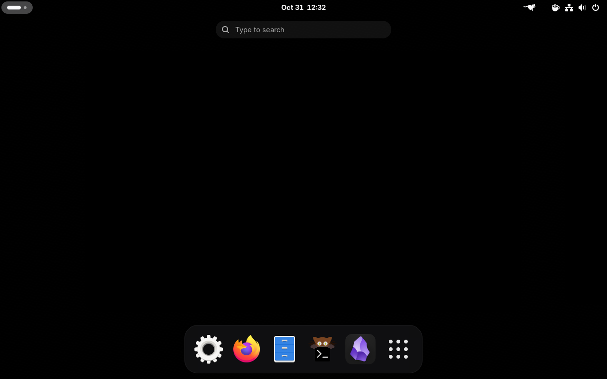
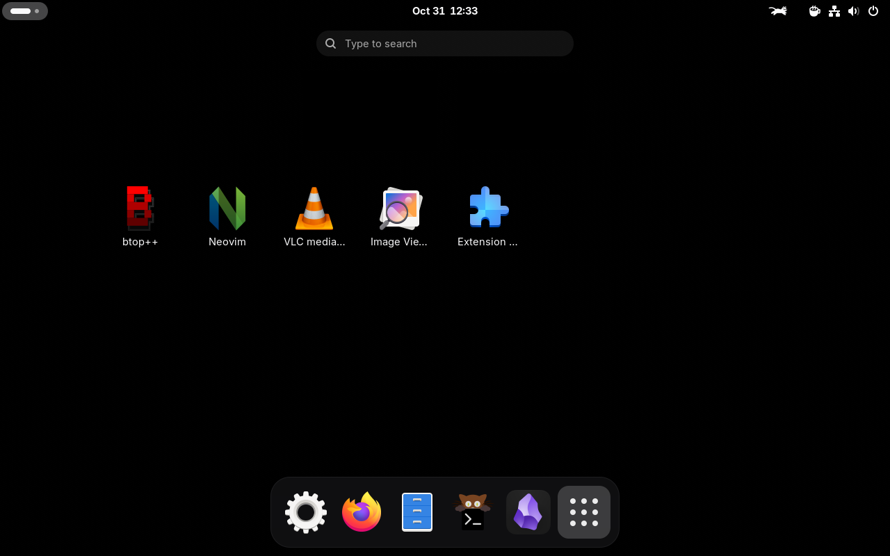

#  Xen

***Xen*** is a image based,  Linux Distro built using `bootc` - no bloat & minimal





## Apps Pre-installed 

- firefox
- image viewer
- kitty
- gnome files
- gnome settings
- gnome disks
- vlc
- obsedian
- neovim
- btop
- extensions app
- fastfetch

## Dev tools Pre-installed
```text gcc gcc-c++ clang clang-tools-extra cmake ninja-build make gdb lldb valgrind 
git curl kgconf-pkg-config openssl-devel 
rust cargo rustfmt clippy rust-analyzer 
python3 python3-pip python3-devel 
nodejs npm golang 
   ```

### Clone
```bash
git clone https://github.com/xenxaarn/xen && cd xen
```
### Build ISO

```bash
./build.sh
```

### License
[MIT](LICENSE)
